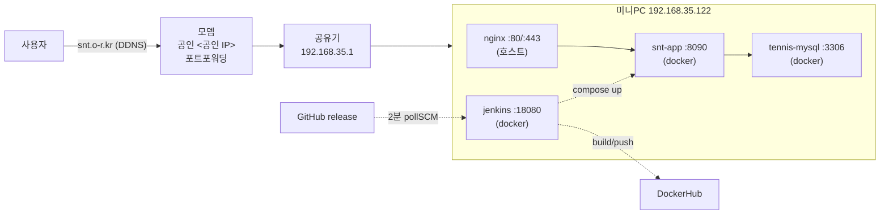
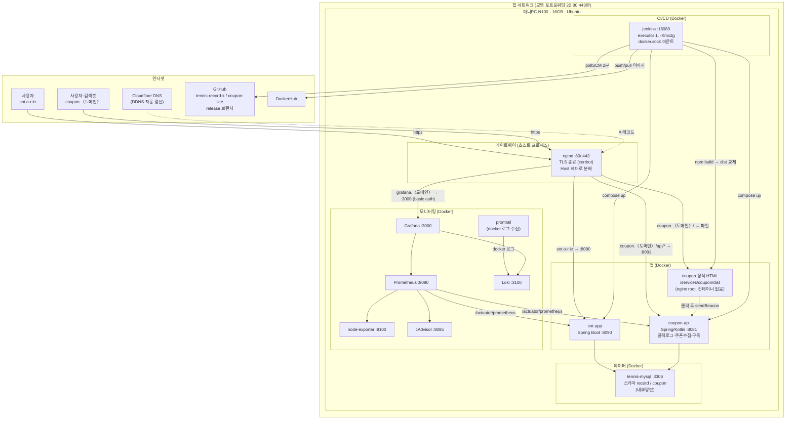

# highjune-archiving

프로젝트 아카이빙 및 Claude Code 세션 자동 저장 시스템

## 기능

### 세션 자동 저장
- 대화창을 닫을 때마다 세션 내용이 자동으로 저장됨
- 프로젝트 계층 구조에 따라 자동 분류:
  - `sessions/tennis-record-k/kakao-vote-automation/` - 카카오톡 투표 자동화
  - `sessions/tennis-record-k/general/` - 테니스 앱 일반
  - `sessions/general/` - 프로젝트 무관 대화

**자동 분류 규칙:**
- "테니스", "tennis", "snt" 키워드 → `tennis-record-k/` 하위
  - 추가로 "카카오톡", "투표", "vote" 키워드 → `kakao-vote-automation/`
  - 그 외 → `general/`
- 위 키워드 없음 → `sessions/general/`

### 프로젝트 문서
- `kakao-vote-automation-plan.md` - 카카오톡 투표 자동화 계획서
- `CLAUDE.md` - 프로젝트 가이드 및 규칙
- `source/projects/tennis-record-k/architecture/home-server-architecture.md` - 홈서버 아키텍처 상세 (포트 실측, 배포 파이프라인, 리스크)
- `source/projects/coupon-site/README.md` - 쿠폰 어필리에이트 사이트 기획·TODO

## 홈서버 아키텍처 (2026-10-15 기준)

Intel 미니PC(Ubuntu) 한 대에 nginx + Docker 컨테이너 3개. `https://snt.o-r.kr`로 외부 공개.



| 외부 포트 | 상태 | 대상 |
|---|---|---|
| 22 | 열림 | SSH (비밀번호) |
| 80 / 443 | 열림 | nginx → snt-app |
| 3306 | **열림 (닫아야 함)** | MySQL 직접 노출 |
| 8080 | 닫힘 | 죽은 규칙 (앱은 8090) |
| 18080 | 닫힘 | Jenkins, 내부망 전용 |

배포는 `release` 브랜치 푸시 한 가지 경로. 상세는 위 아키텍처 문서 참고.

## 목표 아키텍처 (2026-10-15 계획)

원칙: **게이트웨이는 nginx 하나**(80/443 선점, 도메인별 분배, TLS 종료). 앱·DB·CI·모니터링은 전부 Docker. 모니터링은 Prometheus + Grafana(+ Loki 로그). 사용자 요청 경로에는 동적 서버를 두지 않는다.



### 요청·배포·관측 경로

| 경로 | 흐름 |
|---|---|
| 테니스 | 브라우저 → nginx(443) → snt-app:8090 → tennis-mysql(record) |
| 쿠폰 페이지 | 브라우저·검색봇 → nginx(443) → 정적 파일 그대로 응답. DB·JVM 안 거침 |
| 쿠폰 동적 | 버튼 클릭 후 `/api/click` → nginx → coupon-api:8081 → tennis-mysql(coupon). 렌더와 무관 |
| 배포 | `git push origin release` → Jenkins 2분 폴링 → 빌드 → (앱) DockerHub push·compose up / (정적) dist 폴더 교체 |
| 메트릭 | node-exporter·cAdvisor·앱 actuator → Prometheus 스크랩 → Grafana 대시보드 |
| 로그 | 컨테이너 stdout → promtail → Loki → Grafana Explore |

### 외부 노출 포트 (목표)

| 포트 | 대상 | 비고 |
|---|---|---|
| 22 | SSH (키 인증) | 비밀번호 인증 off |
| 80 | nginx → 301 https | |
| 443 | nginx | 모든 서비스의 유일한 입구 |
| 3306, 8080, 8090, 8081, 18080, 9090, 3000 | **닫음** | 내부망·nginx 뒤에서만 |

### 메모리 예산 (16GB)

| 구성 | 예상 |
|---|---|
| nginx | 0.05GB |
| snt-app + coupon-api | 1~1.5GB |
| tennis-mysql (스키마 2개) | 0.5GB |
| Jenkins (-Xmx2g) | 2GB (빌드 중 3GB) |
| Prometheus + Loki + Grafana + exporter | 1.5~2GB |
| **합계** | **5~7GB**, 여유 9GB+ |

## 테스트

세션 저장 기능 테스트:
```bash
./.claude/test-session-save.sh
```