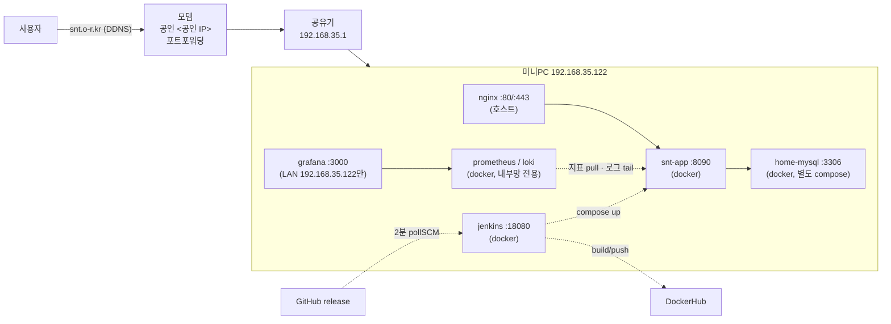
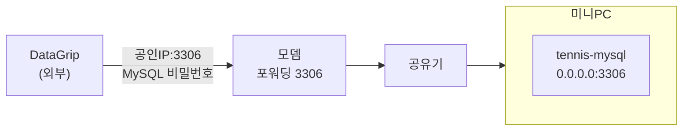
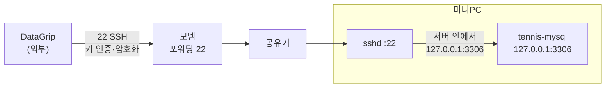
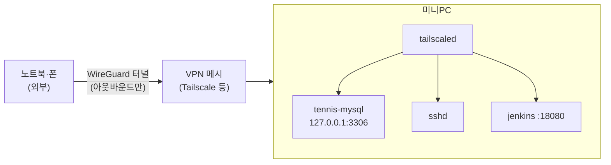
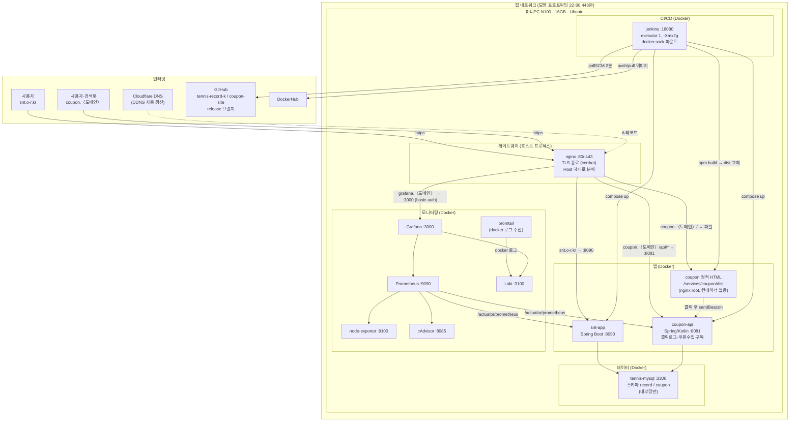
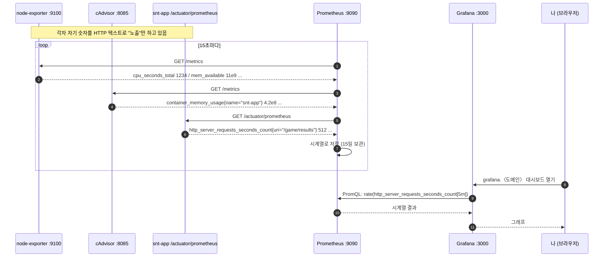
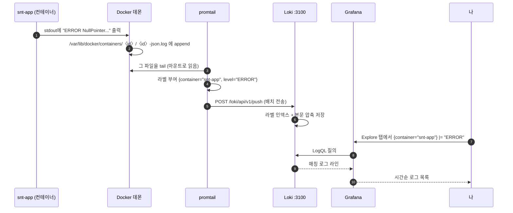

# highjune-archiving

프로젝트 아카이빙 및 Claude Code 세션 자동 저장 시스템

## 기능

### 세션 자동 저장
- 대화창을 닫을 때마다 세션 내용이 자동으로 저장됨
- 프로젝트 계층 구조에 따라 자동 분류:
  - `sessions/tennis-record-k/kakao-vote-automation/` - 카카오톡 투표 자동화
  - `sessions/tennis-record-k/general/` - 테니스 앱 일반
  - `sessions/general/` - 프로젝트 무관 대화

**자동 분류 규칙:**
- "테니스", "tennis", "snt" 키워드 → `tennis-record-k/` 하위
  - 추가로 "카카오톡", "투표", "vote" 키워드 → `kakao-vote-automation/`
  - 그 외 → `general/`
- 위 키워드 없음 → `sessions/general/`

### 프로젝트 문서
- `kakao-vote-automation-plan.md` - 카카오톡 투표 자동화 계획서
- `CLAUDE.md` - 프로젝트 가이드 및 규칙
- `source/projects/tennis-record-k/architecture/home-server-architecture.md` - 홈서버 아키텍처 상세 (포트 실측, 배포 파이프라인, 리스크)
- `source/projects/tennis-record-k/architecture/nginx-architecture.md` - nginx 설정 파일 읽기 순서, server 블록, certbot, 쿠폰 사이트 추가 시 구조
- `source/projects/coupon-site/README.md` - 쿠폰 어필리에이트 사이트 기획·TODO
- [tennis-record-k README](https://github.com/Highjune/tennis-record-k) - 테니스 앱 관점 운영 아키텍처(compose 분리·배포·귀뚜라미/SNT 클럽 분리·ELO 즉시 반영)와 도메인 설계
- `sessions/tennis-record-k/` - 테니스·홈서버 작업 세션 기록

## 홈서버 아키텍처 (2026-10-15 기준)

Intel 미니PC(Ubuntu) 한 대에 nginx + Docker 컨테이너 5개(snt-app, couponnote-api, highnance-alert, home-mysql, jenkins) + 모니터링 6개(prometheus, loki, alloy, grafana, node-exporter, cadvisor). `https://snt.o-r.kr`, `https://couponnote.kr` 외부 공개.

**compose 3개로 분리 (2026-10-24)**: `services/mysql`(home-mysql, 공용 DB) · `services/snt-record`(앱만) · `services/couponnote`(api만) · `services/highnance-alert`(실거래 알림 폴러, 2026-10-29). 앱 compose를 down/up 해도 DB는 내려가지 않는다. 볼륨 `snt-record_mysql-data`·네트워크 `snt-record_app-network`는 external로 공유. 호스트명: 테니스 앱 → `mysql_db`(서비스명), 쿠폰 API → `home-mysql`(컨테이너명).



| 외부 포트 | 상태 | 대상 |
|---|---|---|
| 22 | 열림 | SSH 키 인증만 (비밀번호는 내부망 192.168.35.0/24 전용) + fail2ban |
| 80 / 443 | 열림 | nginx → snt-app |
| 3306 | 닫힘 | 바인딩 127.0.0.1(10/15) + ufw 삭제(10/24) + **모뎀·공유기 포워딩 삭제(10/25)** 3중. 외부에서는 **SSH 터널**로 접근 (아래 "DB 원격 접속 아키텍처") |
| 8080 / 8090 | 닫힘 | 앱 직접 노출 규칙. ufw(10/24)·모뎀 8080·공유기 8090 포워딩(10/25) 모두 삭제. 앱은 nginx 443 뒤에서만 |
| 18080 | 닫힘 | Jenkins, 내부망 전용 |
| 3000 | 닫힘 (LAN 전용) | Grafana. 미니PC LAN 주소에만 바인딩, 포워딩 없음. 밖에서는 SSH 터널 `-L 3000:192.168.35.122:3000` |
| `/actuator/*` | nginx 404 | 두 앱의 지표·헬스는 docker 내부망 Prometheus만 수집 (2026-10-29) |

배포는 `release` 브랜치 푸시 한 가지 경로. 상세는 위 아키텍처 문서 참고.

**모니터링 (2026-10-29)**: 테니스·쿠폰노트 두 앱을 Grafana 한 화면에서. 지표는 Prometheus(앱 `/actuator/prometheus` + node-exporter + cAdvisor, 15s, 30일), 로그는 Docker 컨테이너 로그 → Alloy → Loki(30일, `app`/`level` 라벨). 구성 파일은 [`infra/monitoring`](source/projects/tennis-record-k/infra/monitoring/), 설계·접근 경로는 아키텍처 문서 §6-3. 설계 그림: https://claude.ai/artifact/6YPwJmKub2kom7wN2beGqn

## DB 원격 접속 아키텍처 (2026-10-24 정리)

외부(카페·회사)에서 홈서버 MySQL에 붙는 방법은 세 가지 구조가 있다. 2026-10-15에 MySQL 호스트 포트를 `127.0.0.1`로 묶으면서 ①은 막혔고, 현재는 ②를 쓴다. ③은 다음 단계.

### ① 직접 공개 (비밀번호 방식, ~2026-10-15)



- compose `ports: "3306:3306"` → 모든 인터페이스에 바인딩 → 인터넷에서 MySQL이 직접 보임
- 지키는 것이 **MySQL 비밀번호 하나**뿐. 3306은 스캐너·봇이 상시 두드리는 포트라 무차별 대입 표적
- 전송 암호화도 MySQL 설정에 의존(기본 평문 가능)

### ② SSH 터널 (현재, 2026-10-24~)



- compose `ports: "127.0.0.1:3306:3306"` → 루프백에만 바인딩. 외부 패킷은 서버까지 도달해도 그 주소엔 3306 리스너가 없어 **connection refused**
- 앱(snt-app)은 docker 내부망(`app-network`)으로 DB에 붙으므로 호스트 포트와 무관 → 사이트 영향 없음
- 클라이언트는 22번으로 서버에 들어간 뒤 **서버 안에서** 루프백 3306을 두드림 (bastion/점프 서버와 같은 원리)
- 인터넷에 열린 포트는 22 하나. 인증은 **SSH 키 + MySQL 비밀번호 2중**, 전 구간 SSH 암호화
- 키는 기기별로 서버 `~/.ssh/authorized_keys`에 등록 (개인키 복사 금지, 기기 분실 시 해당 줄만 삭제)

**DataGrip 설정**: SSH/SSL 탭 → Use SSH tunnel (host `snt.o-r.kr`, user `highjune`, Key pair `~/.ssh/id_ed25519`) · General 탭 Host → `127.0.0.1`. 구형 호스트키 거부 시 `~/.ssh/config`에 `HostKeyAlgorithms +ssh-rsa` 추가.

**CLI**: `ssh -N -L 13306:127.0.0.1:3306 highjune@snt.o-r.kr` 후 `mysql -h 127.0.0.1 -P 13306 ...`

### ③ 개인 VPN (Tailscale / WireGuard, 다음 단계)



- 서버가 **아웃바운드로** VPN 메시에 참여 → 모뎀 포트포워딩 자체가 필요 없음 (22도 닫을 수 있음)
- 외부 기기가 "집 내부망에 있는 것처럼" 사설 IP로 접속 → Jenkins(18080) 같은 내부 전용 서비스도 그대로 사용
- 정전·공유기 재부팅으로 WAN IP가 바뀌어도 영향 없음 (현재 리스크 항목 해소)
- 공개 서비스(443 테니스 사이트)는 그대로 포워딩 유지

### 비교

| | ① 직접 공개 | ② SSH 터널 (현재) | ③ 개인 VPN |
|---|---|---|---|
| 인터넷에 열린 관리 포트 | 22 + 3306 | 22 | 없음 |
| 인증 | DB 비밀번호 | SSH 키 + DB 비밀번호 | VPN 신원 + DB 비밀번호 |
| 암호화 | DB 설정 의존 | SSH | WireGuard |
| 접속 가능 기기 | 비밀번호 아는 누구나 | 키 등록된 기기 | VPN 가입 기기 |
| 포트포워딩 의존 | 22·3306 | 22 | 없음 |
| Jenkins 등 내부 서비스 | 불가 | 터널 추가로 가능 | 바로 가능 |

### 남은 할 일
- [x] sshd 비밀번호 인증 off — 인터넷은 키만, 집 내부망(192.168.35.0/24)은 비밀번호 비상 로그인 허용 (`/etc/ssh/sshd_config.d/10-key-only.conf`, 2026-10-24)
- [x] fail2ban 설치 — sshd jail: 10분 내 5회 실패 시 1시간 차단, 내부망 제외 (`/etc/fail2ban/jail.d/sshd.local`, 2026-10-24)
- [x] ufw: 3306·8080·8090·10002·30000 ALLOW 삭제 (2026-10-24, 22/80/443만 남김)
- [x] 모뎀 3306·8080 + 공유기 3306·8090 포워딩 규칙 삭제 (2026-10-25, 집 내부망에서 직접). 외부 3개 노드에서 3306/8080/8090 timeout, 22/443 open 확인
- [ ] ③ Tailscale 도입 검토

## 목표 아키텍처 (2026-10-15 계획)

원칙: **게이트웨이는 nginx 하나**(80/443 선점, 도메인별 분배, TLS 종료). 앱·DB·CI·모니터링은 전부 Docker. 모니터링은 Prometheus + Grafana(+ Loki 로그). 사용자 요청 경로에는 동적 서버를 두지 않는다.



### 요청·배포·관측 경로

| 경로 | 흐름 |
|---|---|
| 테니스 | 브라우저 → nginx(443) → snt-app:8090 → tennis-mysql(record) |
| 쿠폰 페이지 | 브라우저·검색봇 → nginx(443) → 정적 파일 그대로 응답. DB·JVM 안 거침 |
| 쿠폰 동적 | 버튼 클릭 후 `/api/click` → nginx → coupon-api:8081 → tennis-mysql(coupon). 렌더와 무관 |
| 배포 | `git push origin release` → Jenkins 2분 폴링 → 빌드 → (앱) DockerHub push·compose up / (정적) dist 폴더 교체 |
| 메트릭 | node-exporter·cAdvisor·앱 actuator → Prometheus 스크랩 → Grafana 대시보드 |
| 로그 | 컨테이너 stdout → promtail → Loki → Grafana Explore |

### 외부 노출 포트 (목표)

| 포트 | 대상 | 비고 |
|---|---|---|
| 22 | SSH (키 인증) | 비밀번호 인증 off |
| 80 | nginx → 301 https | |
| 443 | nginx | 모든 서비스의 유일한 입구 |
| 3306, 8080, 8090, 8081, 18080, 9090, 3000 | **닫음** | 내부망·nginx 뒤에서만 |

### 모니터링 상세 (메트릭 · 로그 두 파이프라인)

모니터링 구성요소는 전부 **독립 오픈소스 프로그램**이고 각각 Docker 컨테이너 하나로 뜬다. Spring 앱이 직접 하는 건 `/actuator/prometheus` 엔드포인트를 여는 것뿐이다.

| 구성 | 종류 | 역할 | 포트 |
|---|---|---|---|
| node-exporter | Go 바이너리 (Prometheus 프로젝트) | 호스트 OS의 CPU·메모리·디스크·네트워크를 숫자로 노출 | 9100 |
| cAdvisor | Go 바이너리 (Google) | docker.sock을 읽어 **컨테이너별** CPU·메모리·IO를 숫자로 노출 | 8085 |
| Spring Actuator | 앱 내장 라이브러리 (`spring-boot-starter-actuator` + `micrometer-registry-prometheus`) | 앱 내부 지표(요청 수·응답시간·JVM 힙·DB 커넥션 풀)를 `/actuator/prometheus`로 노출 | 앱 포트 |
| **Prometheus** | 시계열 DB + 수집기 | 위 3곳을 15초마다 HTTP로 긁어(pull) 저장. PromQL로 질의. 알림 규칙 평가 | 9090 |
| promtail | Loki 에이전트 | `/var/lib/docker/containers/*/*.log`를 tail해서 라벨(컨테이너명) 붙여 Loki로 push | 9080 |
| **Loki** | 로그 저장소 (Grafana Labs) | 로그 본문을 압축 저장, 라벨 인덱스로 검색. "Prometheus의 로그판" | 3100 |
| **Grafana** | 시각화·알림 UI | Prometheus·Loki를 데이터소스로 등록해 대시보드·그래프·알림 | 3000 |

#### 메트릭 파이프라인 (pull 방식)



핵심: **Prometheus가 능동적으로 긁어간다(pull).** exporter들은 수동적으로 "현재값"만 보여주는 웹페이지다. `curl localhost:9100/metrics` 하면 사람이 읽을 수 있는 텍스트가 그대로 나온다.

#### 로그 파이프라인 (push 방식)



핵심: **로그는 앱이 stdout에 쓰면 끝.** 앱은 Loki를 모른다. Docker가 파일로 받아두고 promtail이 그걸 읽어 밀어넣는다(push). 그래서 어떤 언어·프레임워크든 로그 수집 코드 변경이 없다.

#### 둘을 합쳐 쓰는 순간

```
Grafana 대시보드에서 14:59에 에러율 그래프가 튐 (메트릭)
  → 같은 화면에서 그 시각 로그 패널 클릭 (로그)
  → {container="snt-app"} |= "ERROR" 14:58~15:00
  → "RecordService:42 NullPointer" 발견
```

#### 개념 정리 (헷갈렸던 것들)

**시계열(time series)** = 한 대상을 시간 순으로 잰 숫자의 줄. "미니PC CPU 사용률"이 시계열 하나, "snt-app 메모리"가 또 하나. 15초마다 점이 붙어 그래프 선 한 줄이 된다.

**라벨(label)** = 시계열이 누구 것인지 구분하는 `키="값"` 꼬리표. 지표 이름이 같아도 라벨이 다르면 다른 시계열이다.

```
container_memory_bytes{name="snt-app"}         ← 시계열 1
container_memory_bytes{name="tennis-mysql"}    ← 시계열 2
http_requests_total{uri="/game/results", status="200"}  ← 시계열 3
```

MySQL로 비유하면 라벨은 `GROUP BY`에 쓰는 분류 컬럼, 시계열은 그 그룹 하나, 점은 그룹 안의 행 하나 `(time, value)`.

**Prometheus 저장 방식** — CSV가 아니라 자체 바이너리(TSDB). 라벨 조합 → 시계열 ID 역색인을 두고, 각 시계열의 점들은 2시간 청크로 묶어 시각은 차분, 값은 XOR로 압축(점당 약 1.4바이트). `curl :9100/metrics`로 보이는 텍스트는 수집 순간의 전송 포맷일 뿐이다. 보관 기간은 `--storage.tsdb.retention.time=90d`처럼 옵션 하나로 늘린다. 홈서버 규모면 1년도 몇 GB.

**Loki 조회 방식** — 본문은 인덱스하지 않는다. 두 단계로 찾는다.

```
{container="snt-app", level="ERROR"} |= "NullPointer"
 └ 1단계: 라벨+시간 인덱스로 청크 위치 찾기 (MySQL 복합 인덱스와 동일)
                                      └ 2단계: 그 청크를 풀며 한 줄씩 grep (LIKE '%..%'와 동일)
```

1단계에서 범위를 수천 줄로 줄여놓기 때문에 2단계 풀스캔이 감당된다. 그래서 라벨은 컨테이너명·레벨처럼 **값이 적은 것만** 둔다. `user_id` 같은 고유값을 라벨로 넣으면 시계열 폭발. 회사 로그몬(OpenSearch)은 본문 단어 전체를 역색인해 아무 키워드나 즉시 찾지만 메모리를 수 GB 쓴다. Loki는 그걸 포기하고 가볍게 간 선택.

**Prometheus vs Loki** — 둘 다 "시간 순으로 쌓이는 저장소"이고 동등한 층에 나란히 있다. 담는 게 숫자냐 문장이냐만 다르다.

| | Prometheus | Loki |
|---|---|---|
| 내용물 | 숫자 (CPU 37.2, 요청수 512) | 문장 (ERROR NullPointer at ...) |
| 할 수 있는 것 | 평균·증가율 등 **계산** → 그래프 | 포함 검색 → 원인 추적 |
| 인덱스 | 지표·라벨 전체 | 라벨·시간만, 본문은 grep |
| 수집 | 자기가 긁어옴 (pull) | promtail이 밀어넣음 (push) |
| 질의어 | PromQL | LogQL (라벨 문법 동일) |

**Grafana** — 데이터를 저장하지 않는다. 데이터소스 **플러그인(어댑터)** 구조로, 패널마다 어느 저장소에 어떤 질의어로 물어볼지 조립해 HTTP로 보내고 결과만 그린다. Prometheus·Loki 외에 MySQL·OpenSearch·CloudWatch 등 수십 종을 지원한다. 그래서 한 대시보드에 "Prometheus 그래프 + Loki 로그 + MySQL에서 뽑은 테니스 경기 수"를 같이 둘 수 있다. MySQL을 붙일 땐 읽기 전용 계정으로.

**왜 이 셋을 묶어 쓰나 (PLG 스택)** — Prometheus는 CNCF 독립 프로젝트(2012, SoundCloud 출신). Grafana Labs가 2018년 "Prometheus의 로그판"을 목표로 Loki를 같은 라벨 문법으로 만들었고, 그래서 Grafana 안에서 메트릭 그래프의 라벨을 그대로 들고 로그로 넘어갈 수 있다. 강제 조합은 아니다. Prometheus + Grafana만 쓰거나 로그는 ELK로 가는 곳도 많다(회사는 메트릭 Datadog, 로그 OpenSearch). 홈서버처럼 가볍게 가야 할 때 가장 흔한 세트라서 선택.

#### 도입 순서

1. Prometheus + node-exporter + cAdvisor + Grafana (서버·컨테이너 숫자부터)
2. snt-app에 actuator 의존성 추가 → Prometheus 스크랩 대상 추가 (앱 내부 지표)
3. Loki + promtail (로그). 이때 Spring 앱은 JSON 구조화 로그(`logging.structured.format.console=ecs`)로 통일해 promtail이 `level`을 라벨로 뽑게 한다. nginx·MySQL은 자체 포맷이라 `regex` 스테이지로 별도 파싱
4. Grafana 알림: 메모리 90%·디스크 85%·앱 다운 시 슬랙/메일

### 메모리 예산 (16GB)

| 구성 | 예상 |
|---|---|
| nginx | 0.05GB |
| snt-app + coupon-api | 1~1.5GB |
| tennis-mysql (스키마 2개) | 0.5GB |
| Jenkins (-Xmx2g) | 2GB (빌드 중 3GB) |
| Prometheus + Loki + Grafana + exporter | 1.5~2GB |
| **합계** | **5~7GB**, 여유 9GB+ |

## 테스트

세션 저장 기능 테스트:
```bash
./.claude/test-session-save.sh
```