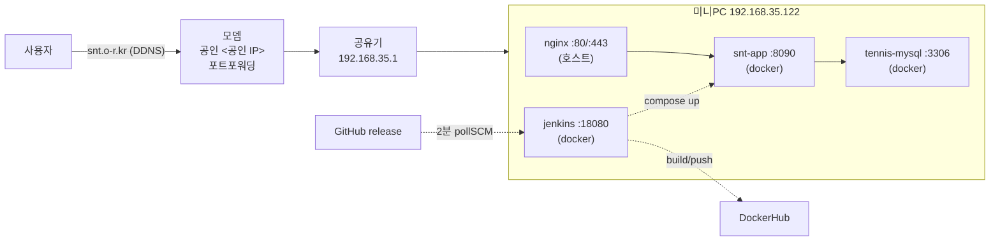

# highjune-archiving

프로젝트 아카이빙 및 Claude Code 세션 자동 저장 시스템

## 기능

### 세션 자동 저장
- 대화창을 닫을 때마다 세션 내용이 자동으로 저장됨
- 프로젝트 계층 구조에 따라 자동 분류:
  - `sessions/tennis-record-k/kakao-vote-automation/` - 카카오톡 투표 자동화
  - `sessions/tennis-record-k/general/` - 테니스 앱 일반
  - `sessions/general/` - 프로젝트 무관 대화

**자동 분류 규칙:**
- "테니스", "tennis", "snt" 키워드 → `tennis-record-k/` 하위
  - 추가로 "카카오톡", "투표", "vote" 키워드 → `kakao-vote-automation/`
  - 그 외 → `general/`
- 위 키워드 없음 → `sessions/general/`

### 프로젝트 문서
- `kakao-vote-automation-plan.md` - 카카오톡 투표 자동화 계획서
- `CLAUDE.md` - 프로젝트 가이드 및 규칙
- `source/projects/tennis-record-k/architecture/home-server-architecture.md` - 홈서버 아키텍처 상세 (포트 실측, 배포 파이프라인, 리스크)

## 홈서버 아키텍처 (2026-10-15 기준)

Intel 미니PC(Ubuntu) 한 대에 nginx + Docker 컨테이너 3개. `https://snt.o-r.kr`로 외부 공개.



| 외부 포트 | 상태 | 대상 |
|---|---|---|
| 22 | 열림 | SSH (비밀번호) |
| 80 / 443 | 열림 | nginx → snt-app |
| 3306 | **열림 (닫아야 함)** | MySQL 직접 노출 |
| 8080 | 닫힘 | 죽은 규칙 (앱은 8090) |
| 18080 | 닫힘 | Jenkins, 내부망 전용 |

배포는 `release` 브랜치 푸시 한 가지 경로. 상세는 위 아키텍처 문서 참고.

## 테스트

세션 저장 기능 테스트:
```bash
./.claude/test-session-save.sh
```