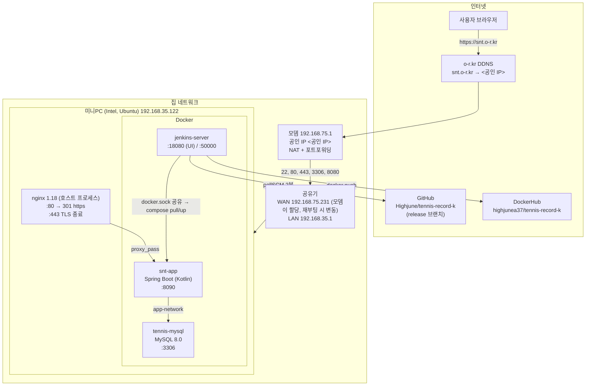
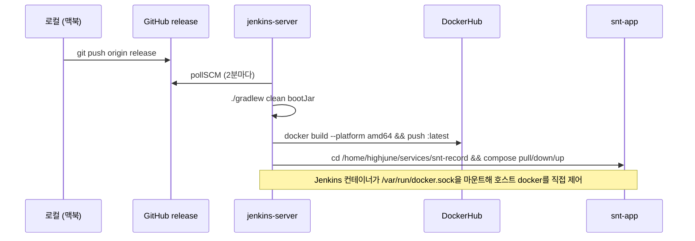

# 홈서버 아키텍처 (현재 상태)

- 기준일: 2026-10-15 (외부 포트는 맥북에서 `nc`/`curl`로 실측)
- 원본 설정 문서: `tennis-record-k/CLAUDE.md` "개발 운영" / "네트워크 인프라" 섹션
- 비밀번호·키 값은 이 문서에 적지 않는다. compose 파일과 Jenkins Credentials를 본다.

## 1. 전체 구성도



## 2. 외부에서 열린 포트 (실측)

| 외부 포트 | 상태 | 뒤에 있는 것 | 비고 |
|---|---|---|---|
| 22 | 열림 | sshd (비밀번호 인증) | 외부 SSH 가능 |
| 80 | 열림 | nginx → `301 https://snt.o-r.kr/` | |
| 443 | 열림 | nginx → snt-app :8090 | `Server: nginx/1.18.0 (Ubuntu)` |
| 3306 | 닫힘 | home-mysql | 바인딩 `127.0.0.1`(10/15) · ufw 삭제(10/24) · 모뎀·공유기 포워딩 삭제(10/25). 외부에서 timeout |
| 8080 | 닫힘 | (없음) | 죽은 모뎀 포워딩 규칙 → 2026-10-25 삭제 |
| 8090 | 닫힘 | snt-app | nginx 뒤에서만 접근 (정상) |
| 18080 | 닫힘 | jenkins-server | 내부망에서만 접근 (정상) |

## 3. 요청이 흐르는 순서

```
브라우저 → DNS(snt.o-r.kr) → <공인 IP>:443
  → 모뎀 포트포워딩(443 → 192.168.75.231)
  → 공유기 → 192.168.35.122:443
  → nginx (443 소켓을 점유 중인 유일한 프로세스)
  → proxy_pass → 127.0.0.1:8090 (snt-app 컨테이너)
  → app-network → tennis-mysql:3306
```

nginx가 "제일 먼저" 받는 이유는 특별한 설정이 아니라 **OS 소켓 바인딩**이다. 한 포트는 한 프로세스만 listen할 수 있고, nginx 설정의 `listen 80; listen 443 ssl;`이 그 포트를 잡고 있으니 그 포트로 오는 패킷은 전부 nginx에게 간다. 컨테이너들은 8090/3306/18080처럼 다른 포트를 쓰므로 충돌이 없다.

## 4. 배포 파이프라인



- `main`이 아니라 **`release` 브랜치 푸시가 운영 배포 트리거**
- Jenkins UI(18080)는 외부에서 못 들어가므로 release 푸시가 유일한 원격 배포 경로
- GitHub 인증: Deploy Key(`id_rsa_jenkins.pub`) + Jenkins Credential `highjune-github-ssh`

## 5. 디렉토리

| 경로 | 내용 |
|---|---|
| `/home/highjune/services/snt-record/docker-compose.yml` | mysql_db + app 정의 (비밀번호 포함) |
| `/home/highjune/services/jenkins/` | Dockerfile, docker-compose.yml, run_docker_compose.sh |
| `/etc/nginx/sites-enabled/snt.o-r.kr` | server 블록 1개. 443: `proxy_pass http://localhost:8090` + WebSocket 헤더. 80: `301 → https`. 인증서는 certbot 관리(`/etc/letsencrypt/live/snt.o-r.kr/`), `certbot.timer`로 매일 자동 갱신 확인됨 (2026-10-15 실측). `server_name`의 옛 WAN IP `192.168.75.66`은 2026-10-15 제거(백업 `.bak-20261015`) |
| `/home/highjune/services/jenkins/docker-compose.yml` | 2026-10-15 `JAVA_OPTS=-Xmx1g -Xms256m` 추가. 메모리 4.84GB → 0.44GB. 백업 `docker-compose.yml.bak-20261015` |
| 맥북 `~/.ssh/config` | `Host snt` 별칭 (키 `id_ed25519_highjune`). `ssh snt`로 접속. 비밀번호 인증은 아직 켜져 있음 |
| `/etc/sudoers.d/highjune` | `NOPASSWD:ALL` (2026-10-15). 원격 자동화용 |

## 6. 알려진 리스크 / 할 일

| # | 항목 | 심각도 | 조치 |
|---|---|---|---|
| 1 | **3306 공인 IP 노출** | ~~높음~~ | **완료 2026-10-25**: 모뎀 `snt-record-db` + 공유기 3306 규칙 삭제 (§6-2). DB는 SSH 터널로 접속 |
| 2 | SSH 비밀번호 인증 | 중간 | 키 등록 완료(2026-10-15). `PasswordAuthentication no`는 Tailscale 도입과 함께 |
| 2-1 | MySQL이 `0.0.0.0:3306`으로 바인딩 | ~~중간~~ | **완료 2026-10-15**: compose `127.0.0.1:3306:3306`. 앱은 `mysql_db:3306`(docker 네트워크)라 무영향. 포워딩 규칙은 10/25 삭제 완료 |
| 3 | 정전 시 공유기 WAN IP 변동 → 모뎀 포워딩 3개(22/80/443) 수동 수정 | 중간 | 모뎀 DHCP 고정 할당(192.168.75.231) 또는 Tailscale |
| 4 | 죽은 포워딩 규칙 8080(모뎀)·8090(공유기) | ~~낮음~~ | **완료 2026-10-25** 삭제 |
| 5 | nginx 설정·인증서 갱신 방식이 문서화 안 됨 | 낮음 | `/etc/nginx` 와 certbot 타이머 확인 후 기록 |

## 6-0. MySQL compose 분리 (2026-10-24)

`tennis-mysql`이 테니스 compose 안에 있어 테니스 배포(`compose down`) 때마다 쿠폰 DB까지 내려가던 문제를 해소.

| 디렉토리 | 서비스 | 컨테이너 | 비고 |
|---|---|---|---|
| `/home/highjune/services/mysql` | `mysql_db` | **home-mysql** | 공용 MySQL. 비밀번호는 `.env`. 볼륨 `snt-record_mysql-data`(external, 기존 데이터 그대로) |
| `/home/highjune/services/snt-record` | `app` | snt-app | mysql 제거, 네트워크 external |
| `/home/highjune/services/couponnote` | `api` | couponnote-api | `DB_HOST=home-mysql`로 변경 |

- 네트워크 `snt-record_app-network`는 이름 유지, 세 compose 모두 external 참조
- 테니스 앱은 `jdbc:mysql://mysql_db:3306`(서비스명)으로 접속하므로 코드 변경 없음
- 교체 순단 약 5초(18:24:00→05). 사전 덤프 `~/backup/mysql-all-20261024-1823.sql`, compose 백업 `*.bak-20261024-1823`
- 검증: 행 수 동일(824/61/622/5/34), 테니스 `compose down/up` 시 home-mysql 영향 없음 확인

## 6-1. DB 원격 접속 (2026-10-24)

sshd: 2026-10-24부터 인터넷 접속은 키 인증만(`PasswordAuthentication no`), 내부망 192.168.35.0/24는 `Match Address`로 비밀번호 허용. fail2ban sshd jail(5회/10분 → 1h 차단, 내부망 ignoreip) 가동.

ufw는 2026-10-24에 22/80/443만 남기고 3306·8080·8090·10002·30000 ALLOW를 삭제했다 (docker 공개 포트는 ufw를 우회하므로 실제 방어는 바인딩 주소 + 모뎀 포워딩).

MySQL 호스트 포트는 `127.0.0.1:3306` 바인딩(10/15). 외부에서는 **SSH 터널**(22 → 서버 내부 127.0.0.1:3306)로 접근하며, 2026-10-24 맥북 SSH 키를 `authorized_keys`에 등록해 키 인증 사용. 직접 공개 / SSH 터널 / 개인 VPN 세 구조 비교와 DataGrip 설정은 README "DB 원격 접속 아키텍처" 참고.

## 6-2. 모뎀·공유기 포워딩 정리 (2026-10-25)

집 내부망에서 두 NAT 장비의 포워딩 규칙을 22/80/443 세 개로 줄였다. 이로써 3306 방어는 compose 바인딩(1차) · ufw(2차) · 포워딩 없음(3차)의 3중.

| 장비 | 모델 | 관리 페이지 | 삭제한 규칙 | 남은 규칙 (→ 목적지) |
|---|---|---|---|---|
| 모뎀 (NAT 1) | DASAN H660N | `192.168.75.1` → 기본 설정 → NAT → Port 포워딩 | `snt-record-db` 3306, `snt-record-app` 8080 | SSH 22 · HTTP 80 · HTTPS 443 → `192.168.75.231`(공유기 WAN) |
| 공유기 (NAT 2) | MERCURY RUSH329AC | `192.168.35.1` → 고급 설정 → NAT/라우터 관리 → 포트포워드 | 3306, **8090** | 22 · 443 · 80 → `192.168.35.122`(미니PC) |

- 공유기에는 8080이 아니라 **8090**(앱 컨테이너 직통) 규칙이 있었다. 모뎀에 8090 규칙이 없어 실제로 뚫려 있진 않았지만, 모뎀 설정이 바뀌면 되살아나는 경로라 함께 삭제. 앱은 nginx 443 뒤에서만 접근
- 두 장비 모두 DMZ 비활성 확인
- **외부 검증** (check-host.net 해외 3개 노드, VPN 무관): 22·443 open / 3306·8080·8090 **Connection timed out**. refused가 아니라 timeout = 모뎀에서 폐기됨
- 검증 시 주의: 회사 VPN이 켜진 맥북에서 `nc`로 찌르면 VPN 아웃바운드 정책 때문에 3306·8080이 포워딩과 무관하게 timeout이 난다. 외부 포트 검증은 VPN 밖(폰 LTE, 외부 체크 서비스)에서 할 것
- 모뎀 관리 페이지는 회사 VPN 켠 상태에선 열리지 않는다. VPN이 default 경로를 터널로 가져가면서 맥북이 직접 붙은 대역(192.168.35.0/24)만 로컬로 남기고, 한 홉 바깥인 192.168.75.0/24는 터널로 보내기 때문. VPN을 끄거나 `sudo route -n add -net 192.168.75.0/24 192.168.35.1`(임시)로 우회

## 7. 예정: 쿠폰 어필리에이트 사이트

- 같은 nginx에 `server_name coupon.<도메인>` 블록 추가 → 새 컨테이너(예: :8081)로 proxy_pass
- 도메인은 별도 구매, DNS는 Cloudflare로 관리 (DDNS 자동 갱신 + 정적 호스팅 동시 활용)
- 상세는 결정되면 `features/coupon-site/`에 기록

## 7-1. 2026-10-15 19:4x 외부 접속 두절 (미해결)

- 증상: couponnote-pipeline 빌드 #1이 `Finished: SUCCESS`로 끝난 직후부터 외부에서 22·80·443 전부 타임아웃. 공인 IP `ping`은 응답(모뎀 생존). snt.o-r.kr도 같이 불통.
- 가설: ① 공유기 WAN IP 변동으로 모뎀 포워딩 불일치(문서의 알려진 패턴) ② 서버 행/재부팅 ③ Gradle+docker build 부하(N100 4코어)로 일시 응답 불가. 현장 확인 전까지 **미규명**.
- 확인 순서(집에서): 미니PC 전원·화면 → 공유기 `192.168.35.1` 인터넷연결정보 IPv4가 `192.168.75.231`인지 → 모뎀 `192.168.75.1` 포워딩 로컬 IP 일치 여부 → `docker ps`로 couponnote-api 기동 여부.

## 8. 목표 아키텍처 (2026-10-15 계획)

README의 "목표 아키텍처" 섹션이 정본. 요지:

- 게이트웨이는 **nginx 하나**. Spring Cloud Gateway 등 별도 게이트웨이 두지 않음
- 신규: `coupon` 정적 사이트(nginx root), `coupon-api`(:8081, Docker), `tennis-mysql`에 `coupon` 스키마
- 모니터링: Prometheus + Grafana + Loki/promtail + node-exporter + cAdvisor (Docker, `grafana.<도메인>`으로 nginx 뒤에서 노출)
- 외부 포트는 22/80/443만. 3306·8080 포워딩 삭제
- Jenkins executor 1, `-Xmx2g`
