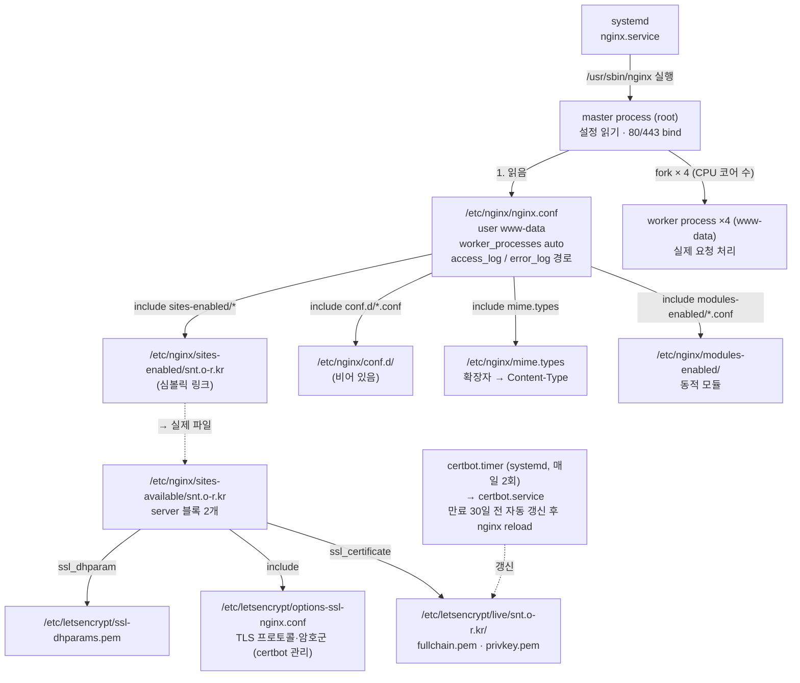
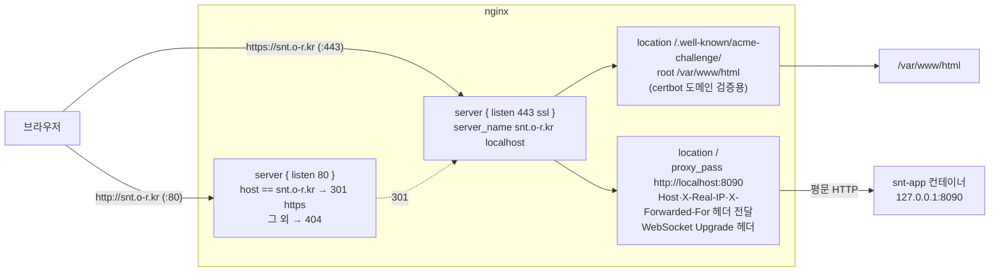
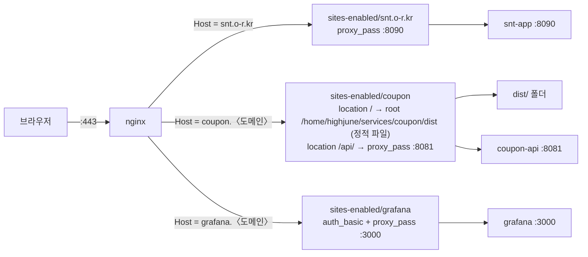

# nginx 구성 (홈서버)

- 실측일: 2026-10-15 (`ssh snt`로 읽음)
- nginx 1.18.0, Ubuntu apt 패키지. 호스트 프로세스로 실행 (Docker 아님)
- 원칙: nginx는 80/443을 선점한 유일한 입구. 뒤의 서비스는 nginx를 통해서만 노출

## 1. 파일이 읽히는 순서



- `sites-available`에 파일을 두고 `sites-enabled`에 **심볼릭 링크**만 거는 게 Ubuntu 관례. 링크를 지우면 비활성, 다시 걸면 활성. 파일 자체는 안 건드린다.
- `sites-available/default`는 링크가 없어서 **읽히지 않는다** (비활성).
- `conf.d/`는 비어 있다. 전역 옵션(gzip, 로그 포맷 등) 추가할 자리.
- 설정 변경 후 적용: `sudo nginx -t` (문법 검사) → `sudo systemctl reload nginx` (무중단 재적용. master가 새 worker를 띄우고 옛 worker를 서서히 종료).

## 2. 현재 server 블록이 하는 일

`/etc/nginx/sites-available/snt.o-r.kr`에 server 블록이 2개.



| 지시어 | 의미 |
|---|---|
| `listen 443 ssl` | 443 포트를 bind. 이 줄이 "nginx가 443의 주인"이 되는 지점 |
| `server_name` | Host 헤더가 이 값일 때 이 블록이 선택됨. 여러 블록이 있으면 Host로 분기 (가상 호스트) |
| `location /` | 경로 매칭. `/`는 전부 |
| `proxy_pass http://localhost:8090` | 받은 요청을 그대로 뒤로 보내고 응답을 돌려줌 (리버스 프록시) |
| `proxy_set_header Host $host` | 뒤의 앱이 원래 도메인을 알게 함 |
| `X-Real-IP`, `X-Forwarded-For` | 뒤의 앱이 실제 클라이언트 IP를 알게 함 (안 넣으면 앱은 127.0.0.1만 봄) |
| `Upgrade` / `Connection "upgrade"` | WebSocket 통과 허용 |
| `# managed by Certbot` | certbot이 `--nginx` 플러그인으로 자동 삽입한 줄. 손으로 고치면 갱신 때 꼬일 수 있음 |

**정리 완료(2026-10-15)**: `server_name`에 있던 옛 공유기 WAN IP `192.168.75.66` 제거. 현재 `server_name snt.o-r.kr localhost;`.

## 3. 로그

| 파일 | 내용 |
|---|---|
| `/var/log/nginx/access.log` | 요청 한 줄씩 (IP, 시각, 메서드, 경로, 상태, UA). logrotate로 매일 회전, `.gz` 보관 |
| `/var/log/nginx/error.log` | nginx 자체 오류, upstream(8090) 연결 실패 등 |

소유자 `www-data:adm`, 권한 640 → 읽으려면 `sudo` 또는 `adm` 그룹. Loki 도입 시 promtail이 이 두 파일을 `regex` 스테이지로 파싱해 수집.

## 4. 쿠폰 사이트 추가 시 바뀌는 것



- 도메인마다 `sites-available/`에 파일 하나 → `sites-enabled/`에 링크 → `certbot --nginx -d coupon.〈도메인〉`으로 인증서 발급 (certbot이 `listen 443 ssl` 블록을 자동 추가)
- 같은 443을 세 도메인이 공유하지만 **Host 헤더로 분기**되므로 충돌 없음 (SNI로 인증서도 도메인별 선택)
- 정적 사이트 블록 예시:

```nginx
server {
    server_name coupon.example.kr;
    root /home/highjune/services/coupon/dist;
    index index.html;
    location / { try_files $uri $uri/ /404.html; }
    location /api/ { proxy_pass http://127.0.0.1:8081; proxy_set_header Host $host; }
    # listen 443 ssl ... ← certbot이 추가
}
```

## 5. 자주 쓰는 명령

```bash
sudo nginx -t                      # 문법 검사
sudo systemctl reload nginx        # 무중단 재적용
sudo systemctl status nginx
sudo tail -f /var/log/nginx/access.log
sudo certbot certificates          # 인증서 만료일 확인
sudo certbot renew --dry-run       # 갱신 리허설
```
